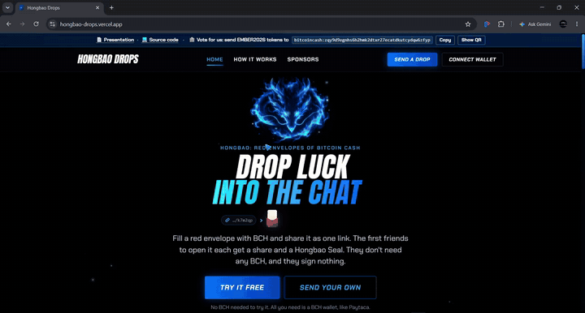
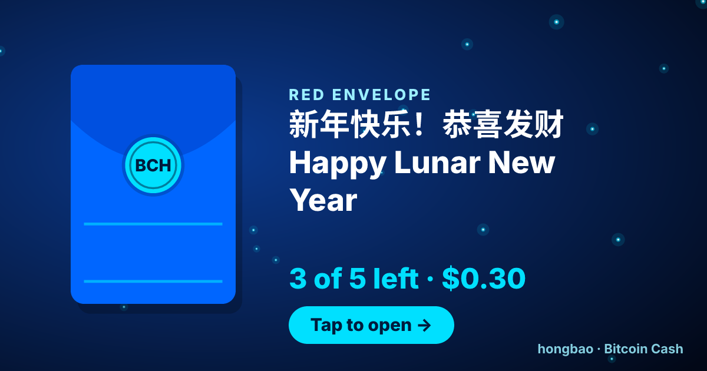
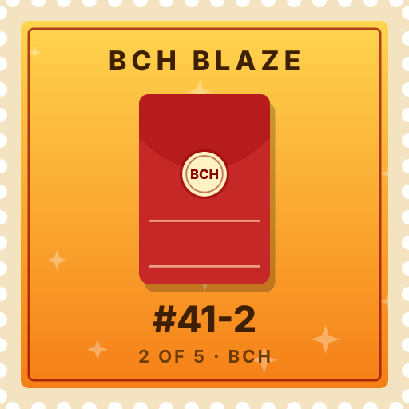

<!--
  Before submission (22 Nov 14:00 UTC):
  1. Refresh the BLAZE Drop rows (snapshot: 19 Nov 21:04 UTC) from
     curl -s https://hongbao-drops-api.vercel.app/campaigns/cmwn5o8eq000107jtj6ecle68/public
  Never put test-network numbers where real ones belong.
-->

# Hongbao Drops 🧧

**Drop a red envelope of Bitcoin Cash into any group chat as one link. The first people to open it each get a share of real BCH and a Hongbao Seal, in seconds, with no fees and nothing to sign.**

### [Try it](https://hongbao-drops.vercel.app) · [Presentation](https://drive.google.com/file/d/1s3yKqtfBycb0cRAPeccTe02Wrn5JKxYC/view) · built for BCH BLAZE 2026 (Mainnet Track)

  
   Real mainnet claim into Paytaca (30 s). <a href="docs/media/flow.mp4">Full 64-second video</a>, including connecting the wallet.

  
  

---

## Try it in 30 seconds

1. **Open [hongbao-drops.vercel.app](https://hongbao-drops.vercel.app) on your phone and tap "Try it free".** It opens today's demo envelope, real BCH on mainnet, refilled every day.
2. **Tap to open it.** Connect your Bitcoin Cash wallet, or paste your BCH address. No wallet yet? Try [Paytaca](https://www.paytaca.com) and tap **"Hold my share"**: we keep a share for you for 15 minutes while you install it.
3. **Watch it arrive.** Your share of BCH and a Hongbao Seal are sent to your wallet within seconds. Some wallets, Paytaca included, show them once the transaction is in a block: Bitcoin Cash makes one about every 10 minutes, so it can take a few minutes to appear. That wait is the network's block time, not the app. The "See it on the explorer" link on the success screen shows it right away.
4. **Pass it on** (optional). Re-gift part of what you got as a new envelope, and see how far your drop travels.

Claiming is free and you don't need any BCH of your own, only a wallet to receive it.

## What just happened

- The sender put BCH into a lockbox on the Bitcoin Cash blockchain, split into shares, one per person.
- The link you opened carries the key to that lockbox. We approve each claim so that each person gets one share.
- Your share went straight from the lockbox to your wallet. Hongbao never held your money.
- Every share comes with its own Hongbao Seal, made at the moment the envelope was created.
- When the envelope expires, leftovers return to the sender automatically. Nobody, not even the sender, can take the money back before then.

## How Hongbao differs

For gifting one friend, maybe on paper, [CashStamps](https://github.com/harvmaster/CashStamps) is the better fit. Hongbao is for groups: one link goes to a chat of 50, and the first N people to open it each get a share. An on-chain contract enforces the expiry and the refund, so the rules don't depend on trusting the sender or us. Hongbao also has lucky and quiz modes, a Hongbao Seal NFT for every claimer, and Sponsored Drops whose cost per activated new wallet anyone can check on-chain.

## Why sponsors pay

Brands and BCH projects want new people using BCH, but airdrops get farmed and ad clicks can't be verified. A **Sponsored Drop** is a branded envelope (logo, colour, a link to the sponsor, optionally a quiz question) for a **3% fee**. In return the sponsor gets a live dashboard:

- how many people claimed;
- how many of them were brand-new wallets;
- how many of those used their BCH or passed it on within 7 days;
- how many looked like farming (flagged, never blocked);
- and the headline number, **cost per real new wallet**.

Every number links to a public blockchain transaction, so anyone can check it, which ad-network click counts can't offer.

**Our own "BLAZE Drop" campaign, live on mainnet:**

| | |
|---|---|
| Envelopes | 3, with 10 shares each and a Hongbao Seal on every share: [equal split](https://blockchair.com/bitcoin-cash/transaction/a6cd35837022184f937114123806f10421c2cac9465ba11e62c0a7ee038de183), [lucky split](https://blockchair.com/bitcoin-cash/transaction/db9744140ba5336d7e890baa10bee08d3168b37632e0435cef878c5bb53f8e08), [equal split](https://blockchair.com/bitcoin-cash/transaction/a163f085a44879a2b773d32fde417d188a203b36f8bffa2bdb6e01e9488a7729) |
| Put in | 300,000 sats (≈ $0.62) |
| 3% sponsor fee, paid on-chain | 9,000 sats: 3,000 in output 11 of each funding transaction, to our treasury |
| People who claimed | 2 (so far, 19 Nov 21:04 UTC) |
| Brand-new wallets | 2 of 2 |
| Envelopes passed on | 0 (so far) |
| **Cost per brand-new wallet** | $0.03 so far: BCH given away plus the sponsor fee, divided by brand-new wallets |
| Of those, used their BCH or passed it on within 7 days | Not known yet: the 7-day window closes after judging |
| Public proof (every transaction) | [hongbao-drops.vercel.app/c/cmwn5o8eq000107jtj6ecle68](https://hongbao-drops.vercel.app/c/cmwn5o8eq000107jtj6ecle68) |

## The business

- **Personal drops are free. Sponsored drops pay 3%** of the envelope (minimum 546 sats), and get their brand on it plus the dashboard above.
- **We pay no miner fees.** On mainnet a claim costs 590 sats ([example](https://blockchair.com/bitcoin-cash/transaction/2c80387481aeecff19a6c826c82479a8e663a385eb81a4d776ba04e826cf34c5)) and refunding 7 leftover shares in one transaction cost 2,949 sats, 421 per share ([example](https://blockchair.com/bitcoin-cash/transaction/7dbc4a861aaae6d82906a8607942f852d734abe53e92dbc273b4d5d78ce33d20)). Both come out of the envelope's own coins. The sender's wallet pays the funding fee: 1,281 sats for a 10-share sponsored envelope. At $207/BCH that's about a tenth of a cent per claim. So the fee is margin; hosting is our only running cost.
- **Self-serve, and the fee can't be skipped.** A sponsor signs up, creates a campaign and funds a drop without talking to us. The funding transaction must pay the fee to our treasury, or the envelope never becomes claimable and its money goes back to the sender at expiry. The gate signs claims only for envelopes whose funding was verified, fee included.
- **Next:** launch with BCH projects and merchants at Lunar New Year, 6 February 2027, when people already expect red envelopes.

Details, sources and the go-to-market plan: [docs/pitch-notes.md](docs/pitch-notes.md).

## Why it's safe

- **We can't take your money.** Opening the lockbox needs the key from the link, and Hongbao never sees that key.
- **Someone with the link can't empty it alone.** Each share needs our approval, which pays one specific share to one specific person.
- **The sender can't take it back early.** Once the envelope is sent, it stays open until it expires.
- **Leftovers can only go back to the sender**, nowhere else.
- **If Hongbao went offline**, claims would pause, but every unclaimed share would still return to its sender.

What it can't do: someone with many wallets can claim more than once. That's why sponsors see "brand-new wallets" and "used it" separately, and why suspected farming is flagged in their dashboard.

### Why there's a cap on each envelope

On mainnet, every envelope, whoever sends it (judges included), can hold **up to $20** of BCH, split into **up to 20 shares**, for **up to 24 hours** before leftovers go back. The Send page shows these limits, and they come straight from the server.

**The reason is safety, not the design.** The contract, the gate and the keeper are new and haven't had an outside security audit yet. If a bug turned up while people use it with real money, the cap keeps what anyone could lose small. $20 is enough to try it properly with a group, and small enough that nobody gets hurt if something goes wrong.

What the cap is *not*:
- **Not a limit of the design.** Nothing in the contract depends on it. The money and share limits are server settings (`MAX_ENVELOPE_USD`, `MAX_SHARES`), and the 24-hour limit is one constant in the API config.
- **Not about our budget.** Envelopes you fund with your own BCH don't count against our demo budget, and you can't block anyone else's.
- **Not permanent.** Once the contract has been reviewed, the limits go up for real sponsored drops.

## See it on the blockchain (mainnet)

| What | Transaction |
|---|---|
| An envelope being sent: today's demo, 10 shares in the lockbox, each with a Hongbao Seal | [eaa86358…](https://blockchair.com/bitcoin-cash/transaction/eaa863585532ef9190c700d98fb3001787371c86c72b6a5ad91003ddd994a4fd) |
| Someone claiming a share into Paytaca: a Hongbao Seal plus 744 sats as plain BCH | [2c803874…](https://blockchair.com/bitcoin-cash/transaction/2c80387481aeecff19a6c826c82479a8e663a385eb81a4d776ba04e826cf34c5) |
| Leftovers returning automatically: 7 unclaimed shares of a demo envelope back to the sender in one transaction, each seal plus 27,389 sats as plain BCH, sent by the keeper | [7dbc4a86…](https://blockchair.com/bitcoin-cash/transaction/7dbc4a861aaae6d82906a8607942f852d734abe53e92dbc273b4d5d78ce33d20) |

Rehearsals on the BCH test network (Chipnet): [envelope sent](https://chipnet.imaginary.cash/tx/e29f87de8794f42e97453477d637dd1afae2b75e6eacac496c08b95b194adc53) · [share claimed](https://chipnet.imaginary.cash/tx/41641d911704c5557e53b763b5b13f9115e02272db94a621cef2966975ded4f9) · [leftovers returned](https://chipnet.imaginary.cash/tx/744ff9d40cf9d0e4dd257f6c9852f3f6ee7da5e0a48b7b0d5c0c5bb308fc74f8).

---

## Technical detail

**Contract.** One CashScript 0.14 contract per envelope, deployed as P2SH32 ([walkthrough](packages/contract/contracts/README.md)). Each share is its own UTXO, so claims never race each other.
- **`claim`** requires the link key's signature *and* a gate datasig over `recipient ‖ outpoint`. One input, one output, a fee bounded by `maxFee`, and the seal NFT must pass through unchanged.
- **`refundBatch`** is keyless and only valid after expiry (CLTV; nodes also wait for median-time-past). It pays only to the sender's script, and uses the 2026 **Layla loop opcodes** to refund many shares in one transaction.

**Hongbao Seals.** The funding transaction is a CashTokens genesis: every share carries an immutable NFT (commitment = envelope ‖ share). A BCMR OP_RETURN points wallets to the metadata (`/bcmr/:category.json`), served byte-for-byte as hashed on-chain. Output 0 is an identity output to the treasury, so the BCMR authchain never moves.

**Gate and API.** NestJS + Prisma + Postgres on Vercel, Neon database.
- **Gate:** the per-envelope gate key is derived from a master seed. The gate checks eligibility (one share per address, wallet fingerprint and hold token; rate limits; quiz answers hashed) and signs only after the funding was verified on-chain, sponsor fee included.
- **Claims:** "fresh wallet" comes from Fulcrum address history; claims are accepted at 0-conf.
- **Keeper** (keyless, every minute via an external cron): batch refunds once median-time-past passes expiry, reconciliation of spends made outside the API, confirmations, 7-day activation and farm flags (`SAME_FINGERPRINT`, `SAME_IP`, `IP_BURST`, `COMMON_SWEEP`, `NEVER_USED`).
- **Also:** live updates over SSE, OG link-preview cards and seal art rendered server-side, and mainnet budget caps enforced server-side.

**Trust model.** The server can't move funds without the link key. A link holder can't drain an envelope without per-claim gate signatures. Refunds go only to the refund script fixed in the contract. If the gate is down, claims stop, but refunds are keyless and still go through.

**Quality.** 263 automated tests (contract VM matrix, API on real Postgres with a mock chain), Chipnet end-to-end suites run against the production URL, and two external code reviews with every finding fixed ([review 1](docs/review-1-fixes.md), [review 2](docs/review-2-fixes.md)). Decisions and research: [docs/findings.md](docs/findings.md).

**For developers:** setup, layout, testing and deployment are in [CONTRIBUTING.md](CONTRIBUTING.md).
