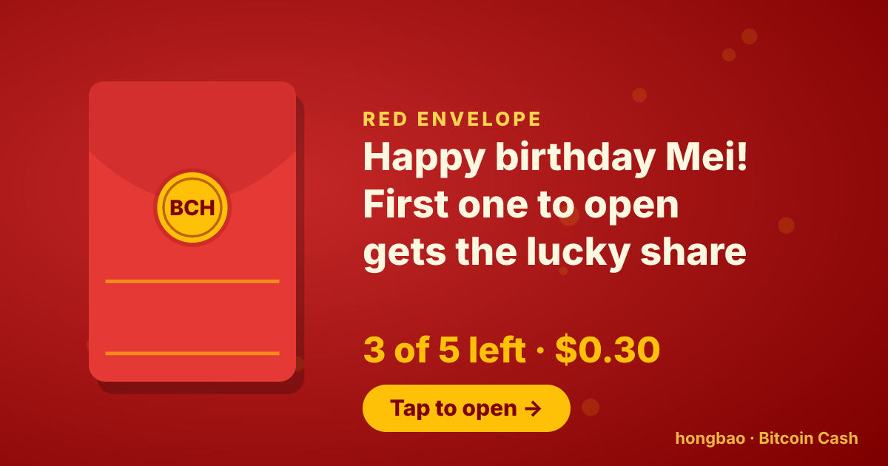
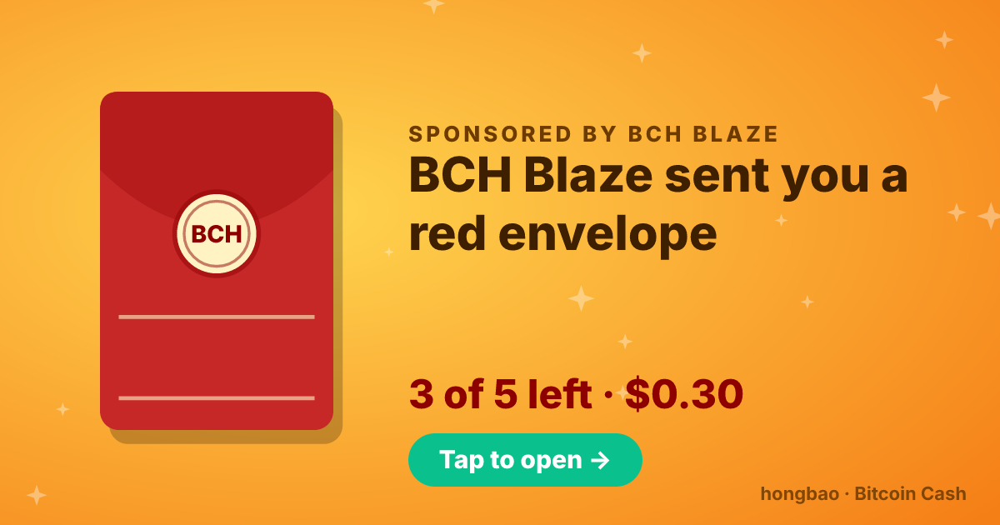
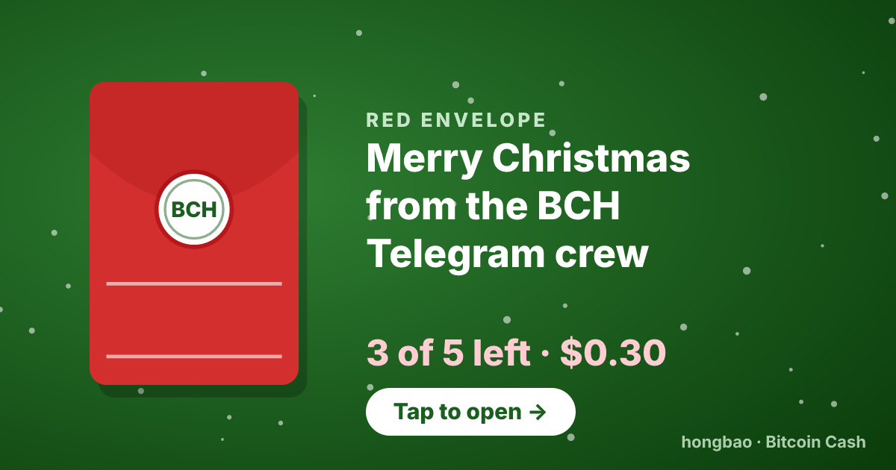
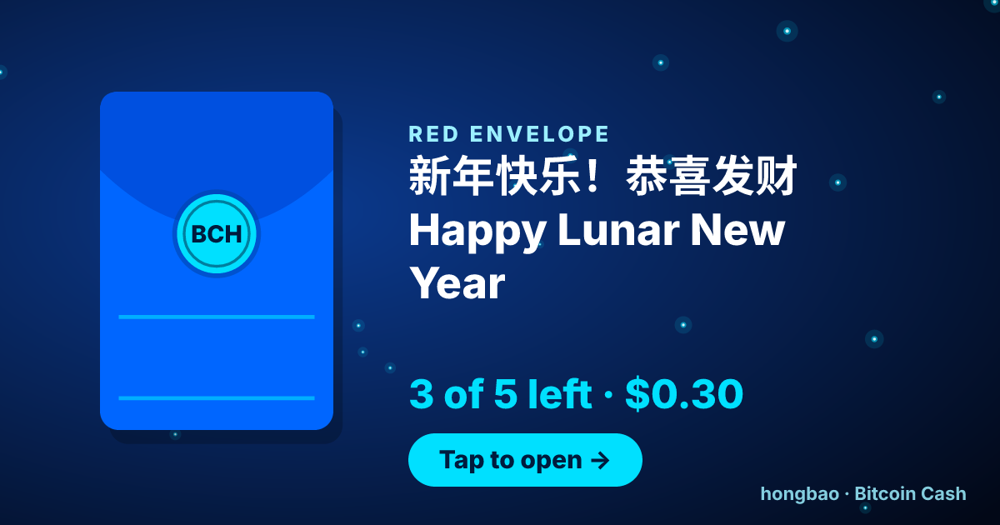
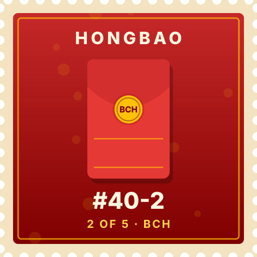
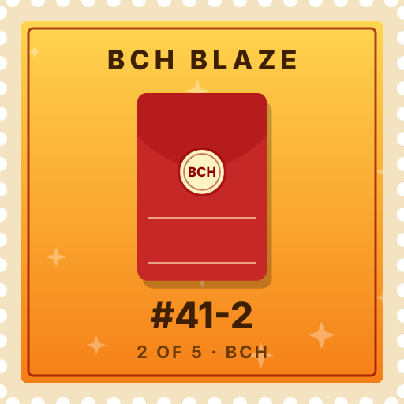
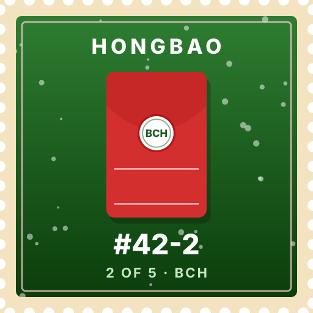
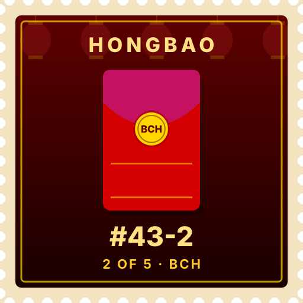

# Phase 6 — Media & stamp metadata

## Link-preview cards: `GET /og/:idOrSlug.png` (1200×630)

Rendered from SVG templates with `@resvg/resvg-js`, about 70–90 ms each. Fonts are bundled (Vercel has no system fonts): Inter, plus Noto Sans SC loaded **only** when the message contains CJK, because red envelopes often carry Chinese greetings. `Cache-Control: max-age=60`, since share counts change. Regenerate these samples with `pnpm --filter @hongbao/api render-samples`.

| classic-red | gold (sponsored: brand colour on the button) |
|---|---|
|  |  |
| **christmas** | **lunar** (CJK message) |
|  |  |

Card states: "Tap to open →" (or "Answer to open →" for quiz), "All grabbed!", "Expired", "Opening soon". The public view (`GET /envelopes/:id`) now includes `og: { imageUrl, alt, width, height }` for the frontend's `og:image` / `twitter:image` tags. Alt text example: *A Lunar New Year red envelope: "Happy New Year!", 3 of 3 shares left*.

## Stamps: `GET /stamps/:category/:commitment.svg|png` and `…/collection.svg|png`

512×512 postage-stamp artwork per share (`#<envelope>-<share>`, "2 OF 5 · BCH", sponsor name as the title when sponsored). Stamps never change, so `Cache-Control: immutable`. Commitments that aren't this envelope's shares → 404.

| classic-red | gold (sponsored) | christmas | lunar |
|---|---|---|---|
|  |  |  |  |

## BCMR: `GET /bcmr/:category.json`

- Serves the registry bytes stored at envelope creation **verbatim**. Their sha256 is committed in the funding tx's OP_RETURN, so re-serialising would break wallet validation. A test hashes the served bytes and compares them to the on-chain hash, then follows every icon/image URI in the registry and checks each one resolves.
- New registries point wallets at **PNG** stamps (`icon`, `image`), because not every wallet renders SVG icons. The SVG endpoint remains. Registries already committed on-chain keep their `.svg` URIs, and those are still served.

## Tests

`apps/api`: 92 passing (9 new in `media.test.ts`):
- one OG card per theme (PNG signature, 1200×630, cache header), including a CJK message;
- by id and by slug, plus 404s;
- stamp SVG/PNG/collection, plus 404s for foreign commitments;
- BCMR hash equality and URI resolution, plus 404s.

## Wallet check (Paytaca)

**Deferred to Phase 8 (builder decision, 2026-11-16).** The wallet, or Paytaca's BCMR indexer, has to fetch the registry and images over **public HTTPS**, and the API only runs on localhost until it is deployed. After the Vercel deploy, run:

```bash
pnpm --filter @hongbao/scripts stamp-to-wallet -- --to <your Paytaca chipnet address> --api <api url>
```

It funds a stamped envelope through the API and claims one share straight to that wallet.

**Update (Phase 8):** run against production on Chipnet. The stamp was delivered and the served BCMR hash matches on-chain. Paytaca's Chipnet view doesn't show WizardConnect-derived addresses (see [phase8-deploy.md](phase8-deploy.md)), so the visual wallet check moves to mainnet.
